<div align="center">


# HireTrack

**흩어진 채용 공고·지원 현황·자기소개서를 한곳에 모으고, "나는 어느 단계에서 떨어지는지"를 숫자로 보여주는 지원 관리 트래커**

[](https://github.com/cjsrudgh98-crypto/HireTrack/actions/workflows/ci.yml)


<br />

<a href="https://cdn.jsdelivr.net/gh/cjsrudgh98-crypto/HireTrack@main/docs/portfolio/HireTrack-portfolio.pdf"></a>
<a href="https://cdn.jsdelivr.net/gh/cjsrudgh98-crypto/HireTrack@main/docs/demo/HireTrack-demo.mp4"></a>

</div>

<p align="center">
  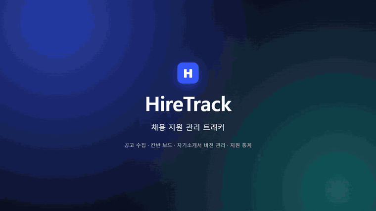
  <br />
  <sub>▲ 실제 서비스 화면 시연 (1.6배속) · 원본 영상: <a href="https://cdn.jsdelivr.net/gh/cjsrudgh98-crypto/HireTrack@main/docs/demo/HireTrack-demo.mp4">HireTrack-demo.mp4</a></sub>
</p>

---

## 목차

- [시연 영상 · 포트폴리오](#-시연-영상--포트폴리오)
- [프로젝트 소개](#-프로젝트-소개)
- [주요 기능](#-주요-기능)
- [화면](#-화면)
- [기술 스택](#-기술-스택)
- [아키텍처](#-아키텍처)
- [기술적으로 고민한 부분](#-기술적으로-고민한-부분)
- [테스트와 CI/CD](#-테스트와-cicd)
- [실행 방법](#-실행-방법)
- [프로젝트 구조](#-프로젝트-구조)
- [문서](#-문서)
- [개발자](#-개발자)

---

## 🎬 시연 영상 · 포트폴리오

| | |
|---|---|
| ▶ **시연 영상** | [HireTrack-demo.mp4](https://cdn.jsdelivr.net/gh/cjsrudgh98-crypto/HireTrack@main/docs/demo/HireTrack-demo.mp4) (1분 16초, 1280×720). 자막으로 단계를 안내하므로 소리 없이 볼 수 있습니다. |
| 📄 **포트폴리오 PDF** | [HireTrack-portfolio.pdf](https://cdn.jsdelivr.net/gh/cjsrudgh98-crypto/HireTrack@main/docs/portfolio/HireTrack-portfolio.pdf) (A4 8쪽): 개요 · 화면 · 시스템 구조 · 기술적 도전과 해결 9가지 · 테스트/CI |

**영상 순서**

1. 칸반 보드: 마감 D-day, 지난 공고, 다가오는 면접
2. 공고 등록
3. 카드를 끌어 상태 변경 (이력 기록)
4. 자기소개서: 자동 임시저장 → 버전 저장 → 버전 비교
5. 처음 지원하는 순간의 답변이 제출본으로 고정
6. 면접 일정 · 제출한 자소서 바로가기
7. 통계: "도달한 단계" 기준 퍼널 · 주간 추이 · 응답 기간 · 조건별 통과율
8. 답변 라이브러리 검색
9. 크롬 확장 프로그램
10. 마감 알림 메일 · 캘린더 구독
11. 모바일 화면

<details>
<summary>영상 · 스크린샷 · PDF는 코드로 다시 만들 수 있습니다</summary>

- 데이터: [`seed-demo.mjs`](docs/demo/seed-demo.mjs)가 API로 예시 계정·공고·자소서·면접을 넣습니다. 데모 전용 PostgreSQL 컨테이너로 띄운 서버라면 등록일·상태 변경 시각을 지난 10주로 펼쳐 차트가 실제 사용처럼 보이게 합니다.
- 스크린샷: [`screenshots.mjs`](docs/demo/screenshots.mjs)가 데스크톱·다크 모드·모바일 화면과 **실제로 로드한 확장 프로그램 팝업**을 찍습니다.
- 영상: [`record-demo.mjs`](docs/demo/record-demo.mjs)가 실제 서버를 브라우저(Edge)로 조작하며 화면을 녹화합니다(Playwright + CDP screencast). [`make-video.mjs`](docs/demo/make-video.mjs)가 ffmpeg로 MP4와 GIF를 만듭니다.
- PDF: [`portfolio.html`](docs/portfolio/portfolio.html)을 [`build-pdf.mjs`](docs/portfolio/build-pdf.mjs)가 A4로 인쇄합니다.

```bash
cd docs && npm install            # playwright-core · ffmpeg-static (브라우저는 설치된 Edge/Chrome 사용)
npm run seed                      # 백엔드(8080) · 프론트(5173) 실행 중
npm run shots                     # docs/screenshots/*.png
npm run demo && npm run video     # docs/demo/HireTrack-demo.mp4 / .gif
npm run pdf                       # docs/portfolio/HireTrack-portfolio.pdf
```

</details>

---

## 📌 프로젝트 소개

취업 준비를 하면서 지원 현황을 스프레드시트 · 메모장 · 북마크에 나눠 적다 보니 이런 일이 반복됐습니다.

- 공고마다 회사명 · 마감일 · 자격요건을 손으로 옮겨 적는 게 번거롭고, **마감을 놓친다**
- 회사마다 비슷한 자소서 문항을 쓰는데, 예전에 잘 쓴 답변을 찾느라 파일을 뒤지고 **어느 회사에 어떤 버전을 냈는지 헷갈린다**
- "나는 서류에서 주로 떨어지나, 면접에서 떨어지나?"를 **감으로만 안다**

**HireTrack**은 이 흐름을 하나로 묶었습니다.

1. **모으기**: 공고 URL을 붙여넣거나, 크롬 확장 프로그램으로 지금 보고 있는 공고 페이지에서 바로 등록합니다.
2. **관리하기**: 칸반 보드에서 카드를 끌어 상태를 바꾸고, 모든 변경은 이력으로 남습니다. 마감 임박 메일과 캘린더 구독으로 놓치지 않습니다.
3. **쓰기**: 자기소개서를 버전으로 관리하고, 지원하는 순간의 답변을 제출본으로 고정합니다.
4. **돌아보기**: "지금 상태"가 아니라 "어느 단계까지 갔는지"로 통과율을 계산해, 약한 단계를 숫자로 보여줍니다.

> 기획부터 백엔드 · 프론트엔드 · 확장 프로그램 · 배포까지 **혼자 진행한 개인 프로젝트**입니다.

---

## ✨ 주요 기능

### 🗂 지원 관리
| 기능 | 설명 |
|---|---|
| **칸반 보드** | 관심 → 지원 완료 → 서류 합격 → 면접 → 결과(최종 합격 / 불합격). 드래그하면 화면을 먼저 바꾸고, 서버가 실패하면 되돌립니다(낙관적 업데이트). |
| **상태 이력** | 모든 변경을 기록합니다. 10분 안에 그대로 되돌린 변경(A→B→A)은 실수로 보고 취소선으로 남긴 뒤 통계에서 뺍니다. |
| **마감 · 면접** | 마감 D-day 배지, 지난 공고는 흐리게. 면접 · 코딩테스트 · 과제 일정을 등록하면 보드 위에 "다가오는 면접"으로 보여 줍니다. |
| **검색 · 메모** | 회사명 · 직무 검색, 고용형태 · 지역 필터, 공고별 메모. |

### ✍️ 자기소개서
| 기능 | 설명 |
|---|---|
| **버전 관리** | 입력하는 동안 자동 임시저장, [버전 저장]을 누르면 새 버전으로 쌓입니다(append-only). 두 버전 또는 편집 중인 내용을 문자 단위로 비교합니다. |
| **제출본 고정** | 처음 "지원 완료"로 바꾸는 순간의 최신 답변이 제출본으로 잠깁니다. 면접 전에 무엇을 냈는지 그대로 확인할 수 있습니다. |
| **글자 수** | 공백 포함 · 공백 제외 · byte 세 가지를 문항의 제한과 함께 보여 줍니다. |
| **답변 라이브러리** | 유형별(지원동기 · 성장과정 · 직무역량 · 협업경험) 템플릿, 내가 쓴 과거 답변 검색, 새 문항에 맞는 템플릿 추천 · 가져오기. |

### 🔗 공고 수집
| 기능 | 설명 |
|---|---|
| **URL 자동 추출** | 서버가 사용자가 넣은 URL을 **한 번만** 요청해 회사명 · 직무 · 근무지 · 마감일 · 자격요건을 채웁니다. 사람인 · 잡코리아 전용 파서 → JSON-LD → Open Graph 순으로 실행하고, 앞 파서가 비운 칸만 뒤 파서가 채웁니다. 실제 공고로 확인한 결과: 잡코리아는 6개 항목 모두, 사람인은 서버 요청으로 회사 · 제목 · 마감일 · 경력/학력(근무지역 · 고용형태는 페이지가 나중에 불러와서 빈칸 안내), **확장 프로그램으로는 6개 모두**. |
| **크롬 확장 프로그램** | 로그인이 필요하거나 JS로 그려지는 페이지도, 아이콘을 누르면 브라우저에 그려진 HTML을 서버의 **같은 파서 체인**이 처리합니다. |
| **안전장치** | SSRF 차단, 응답 시간 · 본문 크기 제한, 사용자별 분당 요청 제한, 사이트별 파서 실패율 지표. 목록 수집 · 자동 크롤링은 하지 않습니다. |

### 📊 통계 · 알림
| 기능 | 설명 |
|---|---|
| **도달 단계 기준 통계** | 지원 퍼널, 서류 통과율, 면접 전환율, 최종 합격률. 결과가 나온 건만 분모에 넣고 결과 대기 건은 따로 보여 줍니다. |
| **추이 · 분포** | 최근 12주 주간 지원 수, 지원 후 첫 결과까지 걸린 기간, 고용형태 · 지역 · 템플릿별 서류 통과율. 모든 차트에 "표로 보기". |
| **마감 임박 메일** | D-7 / D-3 / D-1 중 고른 시점에, 원하는 시각에 하루 한 통으로 모아 보냅니다. |
| **캘린더 구독** | iCal URL을 구글 · 애플 · 아웃룩 캘린더에 등록하면 마감일과 면접이 보이고, 면접 1시간 전에 알림이 울립니다. URL은 언제든 재발급할 수 있습니다. |

### 🔐 회원 · 보안
- JWT 인증, 웹앱 토큰(`APP`)과 확장 프로그램 전용 토큰(`EXTENSION`, 추출 · 등록만 가능)을 분리
- 비밀번호 대입 방어: 이메일당 5번 실패하면 15분 잠금(없는 이메일도 똑같이 세서 가입 여부가 드러나지 않음), IP당 분당 로그인 · 가입 20회
- API 문서(Swagger)는 로컬에서만 열고 운영에서는 끔
- CORS는 고정된 확장 프로그램 ID 하나만 허용, HTML 본문은 3MB 상한
- 모든 공고 · 자소서 · 면접 API는 소유자 확인을 거침(없으면 404, 남의 것이면 403)

---

## 📱 화면

<table>
  <tr>
    <td align="center"><b>칸반 보드</b></td>
    <td align="center"><b>자기소개서 버전 비교</b></td>
    <td align="center"><b>지원 통계</b></td>
  </tr>
  <tr>
    <td>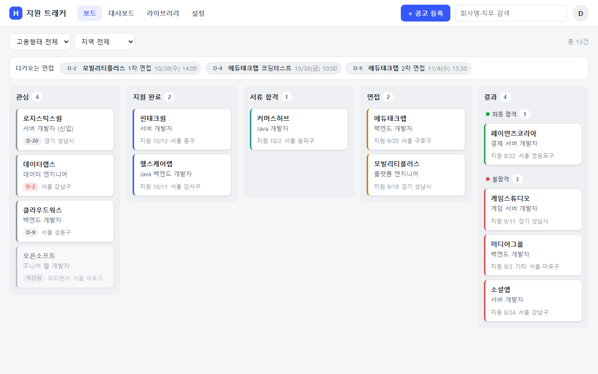</td>
    <td>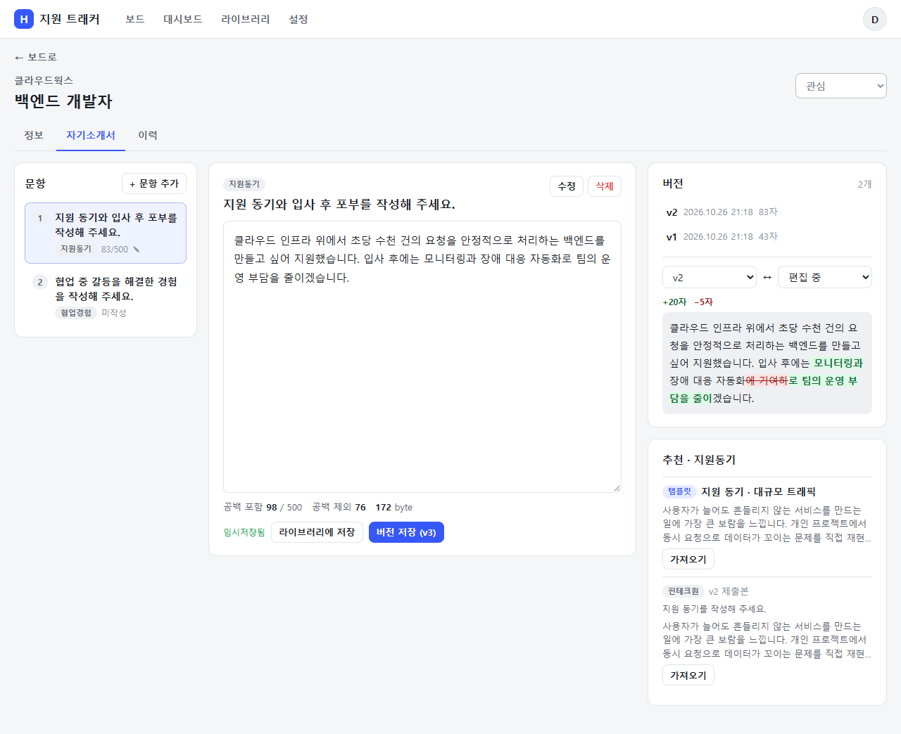</td>
    <td>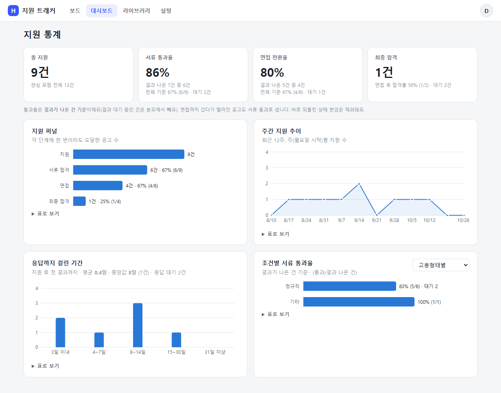</td>
  </tr>
  <tr>
    <td align="center"><b>제출본 고정</b></td>
    <td align="center"><b>면접 일정 · 메모</b></td>
    <td align="center"><b>상태 변경 이력 (되돌림 표시)</b></td>
  </tr>
  <tr>
    <td>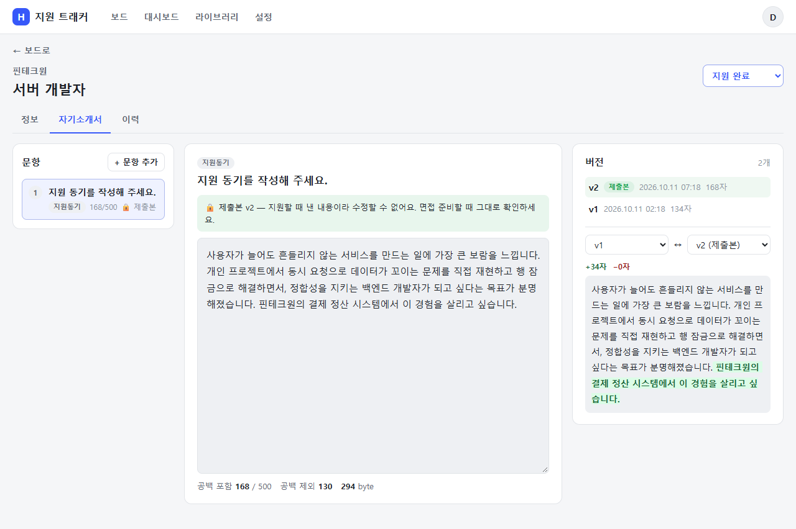</td>
    <td>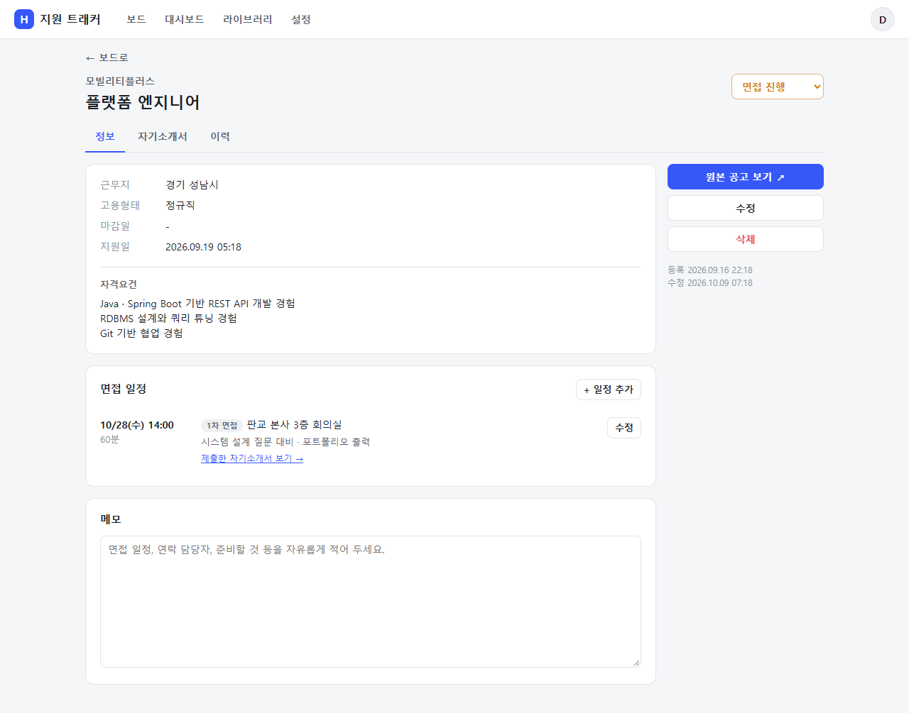</td>
    <td>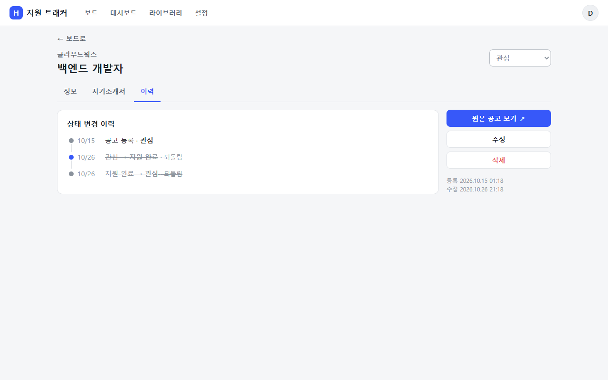</td>
  </tr>
  <tr>
    <td align="center"><b>답변 라이브러리</b></td>
    <td align="center"><b>알림 · 캘린더 구독 설정</b></td>
    <td align="center"><b>공고 등록</b></td>
  </tr>
  <tr>
    <td>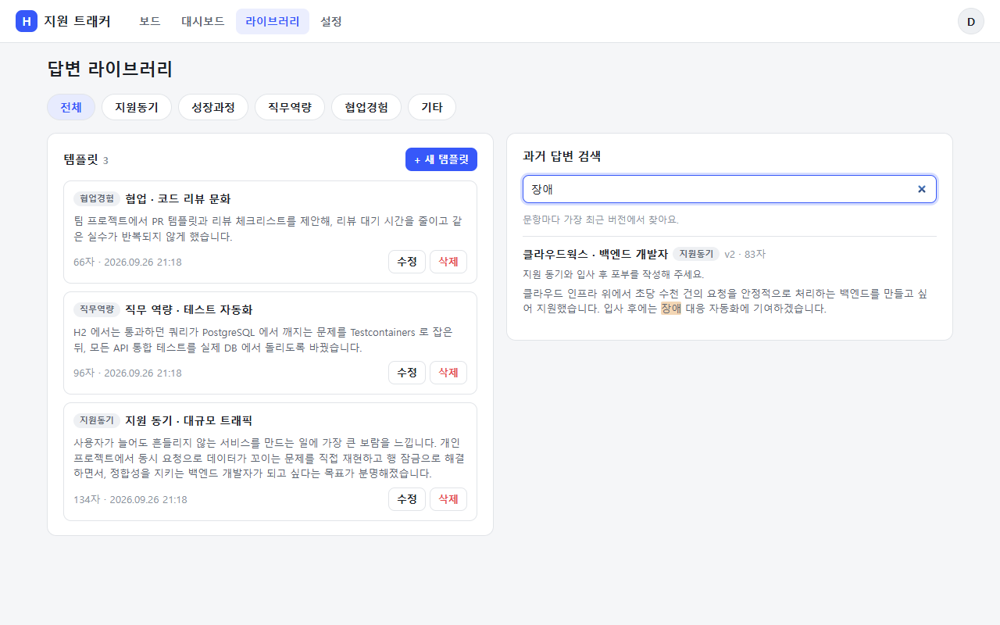</td>
    <td>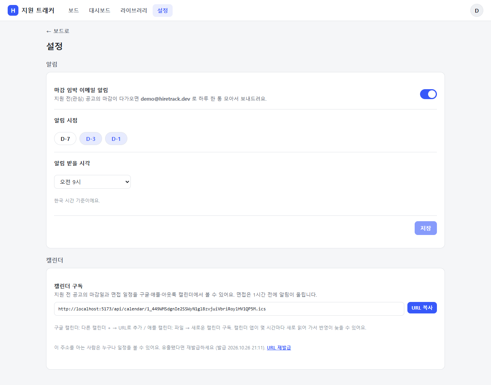</td>
    <td>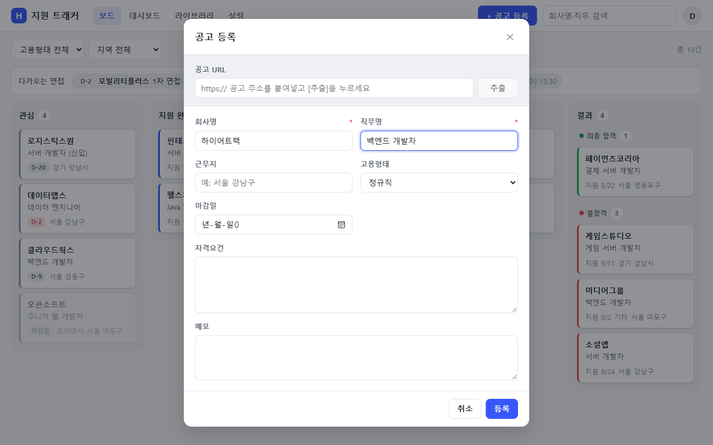</td>
  </tr>
  <tr>
    <td align="center"><b>크롬 확장 프로그램</b></td>
    <td align="center"><b>다크 모드</b></td>
    <td align="center"><b>모바일</b></td>
  </tr>
  <tr>
    <td align="center">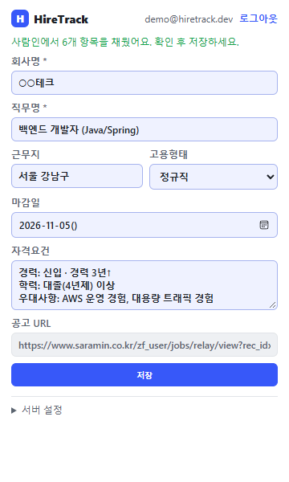</td>
    <td>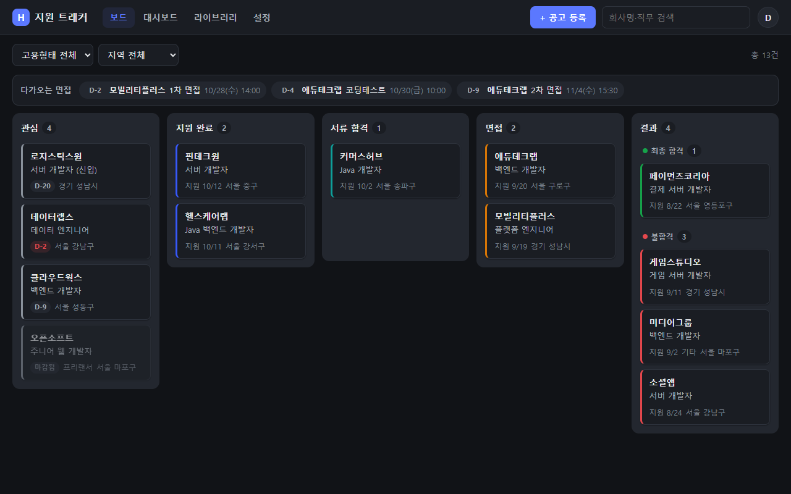</td>
    <td align="center">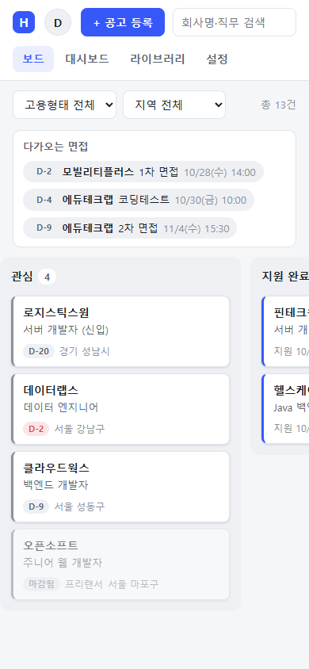 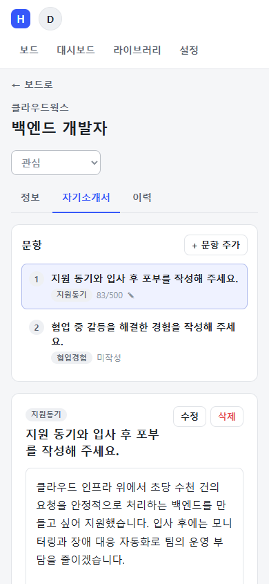</td>
  </tr>
</table>

> 실제 서버를 로컬에서 띄워 브라우저로 촬영했습니다. 회사 · 공고 · 자소서는 모두 촬영용 예시 데이터입니다. 확장 프로그램 화면은 실제로 로드한 확장 프로그램이 사람인 형식 예시 페이지를 서버에서 추출한 결과입니다.

---

## 🧰 기술 스택

| 영역 | 기술 |
|---|---|
| **Backend** | Java 25, Spring Boot 4.0 (Web, Data JPA, Security, Validation, Mail, Actuator), jjwt, Jsoup, Micrometer, springdoc-openapi, Sentry |
| **DB** | PostgreSQL 17 (운영 · 통합 테스트), H2 PostgreSQL 모드 (로컬), **Flyway** 마이그레이션 |
| **Frontend** | React 19, TypeScript, Vite 8, TanStack Query, React Router, dnd-kit, Recharts, diff-match-patch |
| **Extension** | Chrome Manifest V3 (빌드 없는 순수 JS), `activeTab` 권한 |
| **Test** | JUnit 5, Mockito, MockMvc, **Testcontainers**, JaCoCo, Vitest, Testing Library, Playwright |
| **DevOps** | Docker 멀티 스테이지, Docker Compose, Nginx, Let's Encrypt, GitHub Actions, GHCR |

---

## 🏗 아키텍처

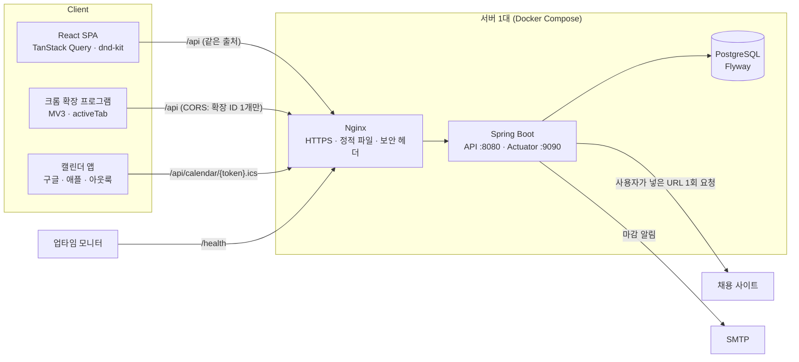

- 웹앱은 Nginx가 같은 주소에서 서빙하고 `/api`만 Spring으로 넘깁니다. Actuator는 별도 포트라 외부에는 `/health`만 열려 있습니다.
- 지원 상태와 도메인 이벤트:

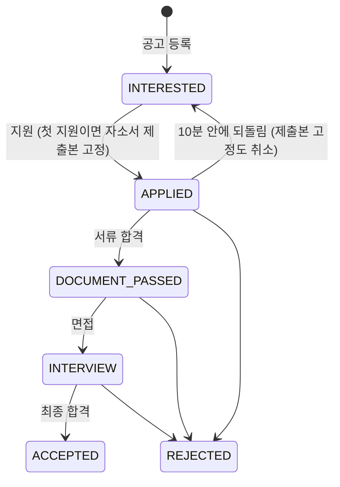

- 테이블 관계:

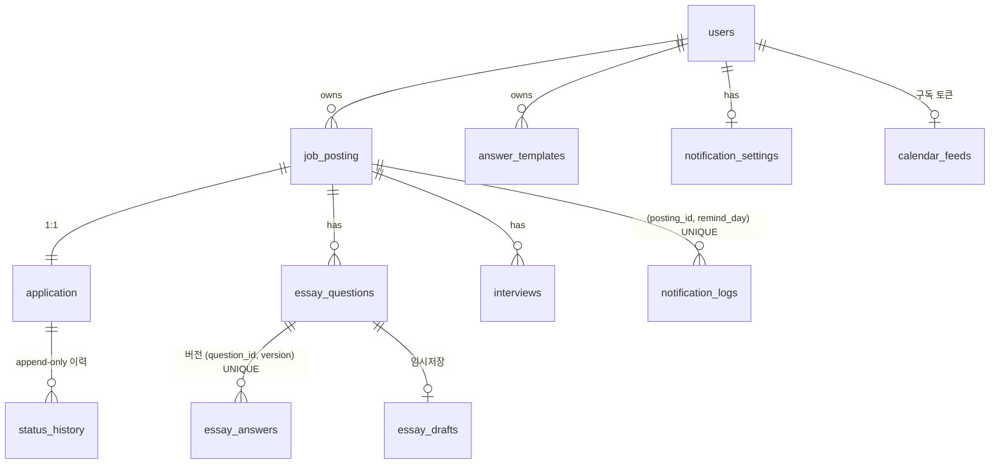

---

## 💡 기술적으로 고민한 부분

<details>
<summary><b>1. 동시에 상태를 바꾸면 이력이 끊기는 문제: PostgreSQL 잠금과 조인한 행</b></summary>

- 같은 공고에 상태 변경 4건을 동시에 보내자, 모두 같은 "이전 상태"를 읽어 이력이 전부 `관심 → X`로 기록됐습니다. 통계가 이 이력으로 계산되므로 숫자가 틀어집니다(빠른 연속 드래그, 웹 · 확장 동시 사용).
- 상태를 바꿀 때 공고 행을 `SELECT … FOR UPDATE`로 잠가 한 줄로 세웠습니다. 그런데 **H2에서만 통과하고 PostgreSQL에서는 여전히 깨졌습니다.** PostgreSQL은 잠금을 기다린 뒤 잠근 행만 최신 값으로 다시 읽고, 함께 조인한 행은 문장 시작 시점의 옛 값을 씁니다.
- 잠금 쿼리에서 지원 레코드 join fetch를 빼고, 잠금을 얻은 뒤 별도 조회로 읽게 바꿨습니다. 이력 순서도 `@OrderBy`로 명시했습니다(PostgreSQL은 UPDATE 뒤 행 순서가 바뀔 수 있음).
- 4개 스레드 동시 변경 테스트를 H2와 PostgreSQL 양쪽에서 돌려 이력 체인이 이어지는지 확인합니다.
</details>

<details>
<summary><b>2. URL 추출의 SSRF 방어</b></summary>

- 사용자가 넣은 URL로 서버가 요청을 보내므로, 그대로 두면 `localhost` · 사설망 · 클라우드 메타데이터(`169.254.169.254`)를 찌를 수 있습니다.
- http/https와 80/443만 허용하고 userinfo(`user@host`)를 거부합니다. 호스트를 DNS 조회해 나온 IP가 **전부** 공인 주소여야 합니다(IPv4-mapped IPv6 · NAT64 포함).
- 리다이렉트를 자동으로 따라가지 않고 hop마다 다시 검사합니다. 로컬 HTTP 서버로 "공인 주소 → 내부 주소" 리다이렉트 우회까지 테스트했습니다.
- 응답 시간 · 본문 크기 제한, 사용자별 분당 요청 제한, 파서 실패율 지표(`hiretrack.parser.results`)를 둡니다. 남은 한계(DNS rebinding)는 문서에 적고 방화벽 아웃바운드 차단을 권장합니다.
</details>

<details>
<summary><b>3. 크롬 확장 프로그램: 최소 권한과 같은 파서 재사용</b></summary>

- 서버 요청 방식은 JS로 그려지는 페이지와 로그인이 필요한 페이지를 못 읽습니다. 확장 프로그램이 **브라우저에 렌더링된 HTML**을 `parse-html`로 보내면 서버의 같은 파서 체인이 처리합니다(스크립트는 JSON-LD만 남기고 제거).
- `<all_urls>` 대신 `activeTab`만 써서 사용자가 아이콘을 누른 탭만 읽습니다.
- 확장 프로그램 토큰은 추출 · 등록 · 내 정보만 가능한 범위 제한 토큰입니다. 웹앱 API를 부르면 403입니다.
- manifest의 `key`로 확장 ID를 고정해, 운영 CORS에 `chrome-extension://{ID}` 하나만 허용합니다. HTML 본문은 JSON 파싱 전에 Content-Length로 3MB를 넘으면 413으로 거릅니다.
</details>

<details>
<summary><b>4. 자기소개서 버전 동시 저장</b></summary>

- 두 탭에서 같은 문항을 동시에 저장하면 같은 버전 번호가 두 번 생기거나, 다른 탭의 내용을 모른 채 덮어쓸 수 있습니다.
- 클라이언트가 본 `baseVersion` 검사와 `(question_id, version)` 유니크 제약의 **두 겹**으로 막습니다.
- 자동 재시도 대신 409를 돌려줍니다. 재시도하면 다른 탭에서 쓴 내용을 모른 채 덮어쓴 "새 버전"이 생기기 때문입니다. 화면은 쓰던 내용을 지우지 않고 최신 버전과 비교해 보여 줍니다.
- 5개 스레드 동시 저장 테스트(PostgreSQL 포함)에서 1건만 저장되고 나머지는 409입니다.
</details>

<details>
<summary><b>5. "지금 상태"가 아니라 "도달한 단계"로 세는 통계</b></summary>

- 현재 상태로 세면 면접까지 갔다가 떨어진 공고가 "불합격"으로만 잡혀 서류 통과율이 낮게 나옵니다. 결과를 기다리는 건을 분모에 넣어도 통과율이 실제보다 낮아집니다.
- 상태 이력에서 공고마다 "한 번이라도 도달한 가장 높은 단계"를 JPQL로 집계합니다. 결과가 나온 건만 분모에 넣고 대기 건은 따로 표시하며, 바로 되돌린 변경은 뺍니다.
- 템플릿에서 시작한 답변을 고쳐 쓴 버전도 출처 템플릿을 이어받게 해서, 제출본 기준 "템플릿별 서류 통과율"을 낼 수 있게 했습니다.
</details>

<details>
<summary><b>6. 마감 알림 스케줄러: 중복 발송과 시간대</b></summary>

- 스케줄러가 겹쳐 돌거나 서버가 여러 대면 같은 메일이 두 번 나갈 수 있고, 서버가 UTC면 D-day가 하루 어긋납니다.
- `(posting_id, remind_day)` 유니크 제약에 발송 기록을 먼저 넣고, 기록과 메일 발송을 한 트랜잭션으로 묶었습니다. 메일이 실패하면 기록도 롤백되어 다음 실행에 다시 시도합니다.
- D-day는 서버 시간대와 상관없이 서울 날짜로 계산하고, 사용자별로 하루 한 통에 모아 보냅니다. 발송 결과는 `hiretrack.reminders{result}` 지표로 봅니다.
</details>

<details>
<summary><b>7. H2에서는 통과하고 PostgreSQL에서 깨지는 쿼리: Testcontainers</b></summary>

- 목록 검색에서 null 파라미터를 PostgreSQL이 `bytea`로 추론해 `varchar like bytea` 오류(500)가 났습니다. H2 테스트는 모두 통과해서, 배포 리허설에서야 발견했습니다.
- `cast(:x as String)`으로 타입을 명시하고, **모든 API 통합 테스트를 Testcontainers PostgreSQL에서도** 돌리도록 서브클래스를 추가했습니다. 스키마는 Flyway로 관리하고 Hibernate는 `validate`만 합니다.
- 이후 1번의 동시성 버그도 이 PostgreSQL 테스트가 잡았습니다.
</details>

<details>
<summary><b>8. 추측으로 만든 파서를 실제 공고로 검증하기</b></summary>

- 사람인 · 잡코리아 전용 파서는 처음에 사이트 구조를 추측해 만든 HTML로 테스트했습니다. 실제 공고에 돌려 보니 **둘 다 맞지 않았습니다.** 사람인은 회사 · 제목만 나왔고, 잡코리아 전용 파서는 매번 실패로 집계됐습니다.
- 원인을 확인해 보니 사람인 공고 페이지는 본문을 자바스크립트로 나중에 불러오는 **껍데기**라 서버가 한 번 요청해서는 본문이 없었습니다. 잡코리아는 예전 요약 표가 사라지고 메타 설명과 JSON-LD로 바뀌어 있었습니다.
- 두 사이트 모두 껍데기에도 들어 있는 `og:title`과 메타 설명("경력:…, 학력:…, 마감일:…")을 읽도록 고쳤습니다. 제목에 쉼표가 있어도 항목이 섞이지 않게 항목 이름으로만 값을 찾습니다.
- 결과: 잡코리아 실제 공고 2/2는 6개 항목 모두, 사람인 3/3은 회사 · 제목 · 마감일 · 경력/학력. 근무지역 · 고용형태는 화면에 "직접 입력" 칸으로 안내합니다. 실제 구조를 따른 픽스처(내용은 가짜)로 테스트를 고정했습니다.
- 사이트가 자동화 브라우저에 응답하지 않아 우회하지 않고, 확장 프로그램 경로는 실제 크롬에서 직접 확인했습니다. 사람인 공고에서 아이콘을 누르면 **6개 항목이 모두** 채워집니다. 서버 요청으로는 4개, 확장 프로그램으로는 6개라서, 입력 경로를 둘로 나눈 이유가 실제 사이트에서 그대로 드러났습니다.
</details>

<details>
<summary><b>9. 배포 리허설 · 자동 롤백 · 백업 복구를 실제로 해 보기</b></summary>

- 운영과 같은 이미지 · compose · 스크립트를 로컬 Docker에서 그대로 돌려 리허설했습니다. 이 과정에서 세 가지가 드러났습니다. 메일 미설정 시 헬스체크가 DOWN이 되어 배포가 매번 롤백됐고, Nginx upstream 이름이 충돌했고, 셸 스크립트가 CRLF여서 리눅스에서 실행되지 않았습니다.
- 메일은 health에서 빼고 지표로 관찰하게 했습니다. upstream 이름을 바꾸고, LF로 통일한 뒤 `.gitattributes`를 추가했습니다.
- 깨진 이미지를 배포하면 헬스체크 실패 → 직전 이미지로 자동 롤백되는지 확인했습니다. DB 볼륨을 통째로 지운 뒤 백업에서 복구한 데이터가 스냅샷과 완전히 같은지도 검증했습니다([기록](docs/OPERATIONS.md#복구-리허설-기록--2026-10-26)).
</details>

---

## ✅ 테스트와 CI/CD

| 구분 | 내용 |
|---|---|
| **백엔드** | JUnit 5 테스트 **177개**, 라인 커버리지 **92.4%**(JaCoCo). 도메인 규칙(상태 이력 · 되돌림 · 제출본 고정), 파서 체인 · SSRF, 자소서 동시 저장, 통계 집계, 알림 중복 방지, iCal 형식, 확장 토큰 범위 · CORS · 413, 로그인 잠금, 동시 요청 회귀, 실제 공고 구조를 따른 파서 픽스처. **API 통합 테스트는 H2와 PostgreSQL(Testcontainers) 양쪽에서** 실행 |
| **프론트엔드** | Vitest + Testing Library: 낙관적 업데이트 롤백, 글자 수 계산, 날짜 · D-day |
| **E2E** | Playwright **4개**: 가입 → 등록 → 상태 변경 → 통계, 마우스 드래그 후 새로고침 유지, 지원 시 제출본 고정, 데스크톱 · 모바일 가로 넘침 검사 |
| **CI** ([`ci.yml`](.github/workflows/ci.yml)) | PR과 main push마다 ① 백엔드(Testcontainers 포함) ② 프론트 lint · test · build ③ E2E ④ Docker 이미지 빌드 |
| **CD** ([`deploy.yml`](.github/workflows/deploy.yml)) | CI 재검증 → GHCR 이미지 푸시(태그 = 커밋 SHA) → SSH로 `deploy.sh` → 헬스체크 실패 시 직전 이미지로 롤백 (`DEPLOY_ENABLED` 변수로 켬) |

```bash
# 백엔드 (Docker가 있으면 PostgreSQL 컨테이너 테스트 포함) + 커버리지 target/site/jacoco
./mvnw verify

# 프론트엔드
cd frontend && npm ci && npm run lint && npm test && npm run build
PW_CHANNEL=msedge npm run e2e     # 채널을 빼면 npx playwright install chromium 필요
```

---

## 🚀 실행 방법

### 요구 사항
- JDK 25
- Node.js 22+ (CI는 24)
- Docker (선택: PostgreSQL 통합 테스트 · 운영 배포)

### 1. 로컬 개발 (Docker 불필요)

```bash
# 백엔드 → http://localhost:8080 (H2 파일 DB, Flyway가 스키마 생성 · Swagger: /swagger-ui.html)
./mvnw spring-boot:run

# 프론트엔드 → http://localhost:5173 (/api는 8080으로 프록시)
cd frontend && npm install && npm run dev
```

### 2. 크롬 확장 프로그램 (압축해제 로드)

1. `chrome://extensions` → 오른쪽 위 **개발자 모드** 켜기
2. **압축해제된 확장 프로그램을 로드합니다** → 이 저장소의 `extension/` 폴더 선택
3. 툴바의 HireTrack 아이콘 → 로그인 → 채용 공고 페이지에서 아이콘을 누르면 추출 결과가 폼에 채워집니다
4. 운영 서버를 쓰려면 팝업 아래 **서버 설정**에서 API · 앱 주소를 바꿉니다

### 3. 운영 배포 (Docker Compose)

```bash
# 서버의 /opt/hiretrack 에서
cp .env.example .env              # 값 채우기 (아래 표) · chmod 600 .env
./scripts/init-letsencrypt.sh     # HTTPS 인증서 최초 발급
./scripts/deploy.sh <이미지 태그>   # 이후에는 GitHub Actions가 실행
```

| 변수 | 용도 |
|---|---|
| `DOMAIN`, `LETSENCRYPT_EMAIL` | 서비스 도메인 · 인증서 알림 메일 |
| `DB_PASSWORD` | PostgreSQL 비밀번호 |
| `JWT_SECRET` | JWT 서명 키 (운영 필수, 기본값 없음) |
| `CORS_ALLOWED_ORIGINS` | `chrome-extension://kkdekpdfgncihpjpjbllcmmpodengigh` |
| `SPRING_MAIL_*` | 마감 알림 메일 (비우면 로그로만 남김) |
| `SENTRY_DSN` | 예외 추적 (선택) |

비밀값은 저장소에 넣지 않고 서버 `.env`와 GitHub Secrets(SSH 접속 정보)로만 관리합니다. 서버 준비 · 모니터링 · 백업/복구 절차는 [`OPERATIONS.md`](docs/OPERATIONS.md)에 있습니다.

---

## 📁 프로젝트 구조

```
HireTrack
├── src/main/java/com/hiretrack/
│   ├── common/            # 보안(JWT · 범위 토큰 · CORS · 요청 크기 제한 · 요청 수 카운터), 에러 응답, 시간대, Swagger
│   ├── user/              # 가입 · 로그인 · 확장 프로그램 로그인 · 로그인 시도 제한
│   ├── posting/           # 공고 · 지원 · 상태 이력 · 도메인 이벤트
│   ├── parse/             # 파서 체인(사람인 · 잡코리아 · JSON-LD · OG), SSRF 방어, 요청 제한, 실패율 지표
│   ├── essay/             # 문항 · 버전 · 임시저장 · 제출본 고정 · 템플릿 · 검색
│   ├── stats/             # 도달 단계 기준 통계 쿼리
│   ├── interview/         # 면접 일정
│   ├── calendar/          # iCal 피드 (RFC 5545)
│   └── notification/      # 마감 알림 스케줄러 · 설정
├── src/main/resources/db/migration/   # Flyway V1~V4
├── src/test/              # 단위 · 통합 · *PostgresTest (Testcontainers)
├── frontend/              # React + TypeScript + Vite
│   ├── src/               # pages · components · hooks · api · lib
│   ├── e2e/               # Playwright
│   └── nginx/             # 운영 Nginx 설정 · 보안 헤더
├── extension/             # 크롬 확장 프로그램 (MV3)
├── deploy/                # docker-compose.prod.yml · 배포 · 백업 · 복구 · 인증서 스크립트
├── docs/
│   ├── demo/              # 시연 영상(MP4 · GIF) + 시드 · 스크린샷 · 녹화 스크립트
│   ├── portfolio/         # 포트폴리오 PDF와 원본 HTML
│   ├── screenshots/
│   └── DESIGN.md · API.md · OPERATIONS.md
└── .github/workflows/     # CI · 배포
```

---

## 📚 문서

- [설계 노트 (DESIGN.md)](docs/DESIGN.md): 도메인 규칙과 기술적 결정
- [API 요약 (API.md)](docs/API.md): 엔드포인트와 에러 코드 (전체 명세는 Swagger UI)
- [운영 가이드 (OPERATIONS.md)](docs/OPERATIONS.md): 배포 · 모니터링 · 백업/복구 · 복구 리허설 기록

---

## 👤 개발자

<table>
  <tr>
    <td align="center" width="160">
      <a href="https://github.com/cjsrudgh98-crypto"></a>
      <br /><b>천경호</b>
      <br /><sub>개인 프로젝트 · 1인 풀스택<br />(기획 · 백엔드 · 프론트엔드 · 배포)</sub>
    </td>
    <td>

| | |
|---|---|
| 📞 **연락처** | 010-7757-5062 |
| ✉️ **이메일** | [cjsrudgh98@gmail.com](mailto:cjsrudgh98@gmail.com) |
| 🐙 **GitHub** | [@cjsrudgh98-crypto](https://github.com/cjsrudgh98-crypto) |

    </td>
  </tr>
</table>

---

<div align="center">

**HireTrack**: 지원 현황을 한곳에서, 끝까지 📋

</div>
